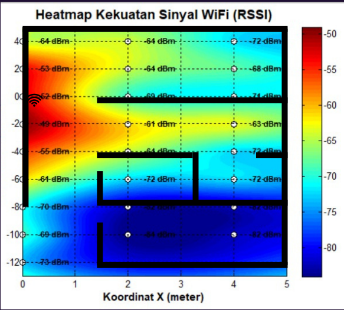

# ESP32-Based Wi-Fi Signal Mapping and Heatmap

A Wi-Fi signal mapping project using an ESP32 as a wireless access point (transmitter) and a Windows laptop as the measurement receiver. The system collects Wi-Fi signal quality data at predefined coordinates to support spatial signal-strength analysis and heatmap visualization.

## Project Overview

This project explores how Wi-Fi signal strength varies across different locations within an indoor environment.

The ESP32 operates as a Wi-Fi Soft Access Point (SoftAP), while a Windows laptop connects to it and measures the received Wi-Fi signal quality. Measurements are collected at predefined sampling points and stored in a CSV file for further analysis.

## System Architecture

1. **ESP32 Transmitter**
   - Operates as a Wi-Fi SoftAP.
   - Broadcasts a wireless network with a configurable SSID and password.
   - Provides a wireless signal source for indoor measurements.

2. **Windows Laptop Receiver**
   - Connects to the ESP32 access point.
   - Reads Wi-Fi signal quality using the Windows `netsh` command.
   - Collects multiple readings at each measurement point.
   - Calculates the average signal quality and records the results in CSV format.

3. **Data Visualization**
   - Measurement data can be processed to visualize the spatial distribution of Wi-Fi signal strength.
   - A sample heatmap image is included in this repository.

## Repository Structure

```text
esp32-wifi-signal-heatmap/
├── .gitignore
├── README.md
├── heatmap_picture.png
├── wifi_receiver_windows.py
└── esp32_wifi_transmitter/
    └── esp32_wifi_transmitter.ino
```

## Hardware and Software Requirements

### Hardware
- ESP32 development board
- Windows laptop with a Wi-Fi adapter

### Software
- Arduino IDE
- ESP32 board package for Arduino IDE
- Python 3
- Windows operating system

## Installation and Setup

### 1. Configure the ESP32 Transmitter

1. Open `esp32_wifi_transmitter/esp32_wifi_transmitter.ino` in Arduino IDE.
2. Select the appropriate ESP32 board and COM port.
3. Upload the program to the ESP32.
4. The ESP32 will create a Wi-Fi network with the following credentials:

| Parameter | Value |
|---|---|
| SSID | `ESP32_WIFI_TX` |
| Password | `wifiheatmap` |
| Wi-Fi Channel | 6 |

### 2. Configure the Laptop Receiver

1. Connect the Windows laptop to the ESP32 Wi-Fi network.
2. Open a terminal in the project directory.
3. Run the receiver program:

```bash
python wifi_receiver_windows.py
```

4. Follow the terminal instructions.
5. Position the laptop at each indicated measurement coordinate and press Enter to collect the readings.

### 3. Measurement Data

The receiver collects 10 readings at each of 25 predefined measurement points.

The measurement results are saved in:

```text
wifi_measurements.csv
```

The CSV file can be opened using Microsoft Excel, Python, or other data-analysis tools.

## Heatmap Visualization

The repository includes a sample heatmap visualization:



The heatmap illustrates the spatial variation of Wi-Fi signal strength across the measurement area.

**Note:** The image is included as a visualization reference. The heatmap-generation script is not currently included in this repository.

## Measurement Limitations

The Windows `netsh wlan show interfaces` command reports Wi-Fi signal quality as a percentage rather than directly providing calibrated RSSI values in dBm.

This project uses the following approximation:

```text
Estimated RSSI (dBm) = Signal Quality (%) / 2 - 100
```

The resulting dBm values are estimates and should not be interpreted as directly measured RSSI.

For more accurate RF measurements, a receiver or wireless driver that exposes calibrated RSSI values should be used.

Measurement consistency also depends on maintaining similar laptop orientation, antenna position, height, and environmental conditions at each sampling point.

## Future Improvements

- Implement direct RSSI measurement in dBm.
- Develop an automated heatmap-generation script.
- Add real-time Wi-Fi signal monitoring.
- Improve measurement accuracy through repeated experiments and calibration.
- Compare signal attenuation across different indoor obstacles and room layouts.

## Project Status

Prototype implementation and measurement workflow documentation.

